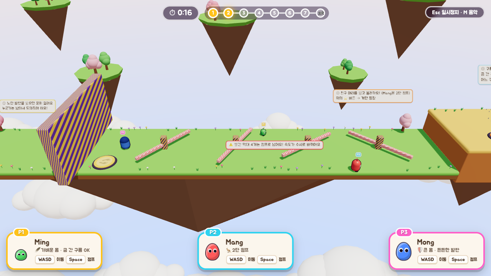

# Ming Mang Mong

세 친구의 협동 퍼즐 어드벤처. 혼자서도, 온라인으로 친구와 함께도 할 수 있는 브라우저 3D 게임입니다.

설치할 것 없이 브라우저에서 바로 실행됩니다 (Three.js는 CDN에서 불러옵니다).


## 게임 소개

### 캐릭터

| 캐릭터 | 능력 |
|---|---|
| 🟢 **Ming** | 🪶 가벼운 몸. 금 간 구름을 밟아도 무너지지 않아요 |
| 🔴 **Mang** | 🦘 2단 점프 |
| 🔵 **Mong** | 🛡️ 큰 몸. 키가 커서 친구를 받쳐 주는 든든한 발판 |

### 챕터

1. **서로 문을 열어줘요**: 노란 발판을 밟으면 문이 열려요. 누군가는 남아서 도와줘야 해요. 그 뒤로 속도가 수시로 바뀌는 빨간 회전 막대 4개를 점프로 넘어요.
2. **어깨 위로 영차!**: 친구 머리를 밟고 올라가 ⭐ 버튼을 누르면 계단이 나타나요.
3. **구름 징검다리**: 움직이는 구름을 밟고 건너요. 금 간 구름은 밟으면 무너지고(Ming은 괜찮아요), 어느 구름이든 2초 넘게 밟고 있으면 떨어져요.
4. **가시밭길을 달려라**: 바닥 어디서 가시가 솟을지 몰라요. 톱니바퀴도 조심!
5. **영차영차, 함께 밀기**: 커다란 상자는 모두 함께 밀어야 움직여요.
6. **하나 둘 셋, 단체 줄넘기**: 줄 안에서 다같이 7번 연속 넘으면 문이 열려요.
7. **다같이 점프!**: 패드 위에서 동시에 점프하면 슈퍼 점프로 골인 지점에 올라가요.

| 회전 막대 넘기 | 구름 징검다리 | 단체 줄넘기 |
|---|---|---|
|  |  |  |

상자 밀기, 줄넘기, 동시 점프처럼 함께 해야 하는 퍼즐은 **접속한 사람 모두**가 참여해야 성공해요. 혼자 할 때는 혼자서도 풀 수 있게 조건이 바뀌어요.

### 조작

| 키 | 동작 |
|---|---|
| `WASD` / 방향키 | 이동 |
| `Space` | 점프 |
| `R` | 체크포인트로 돌아가기 |
| `Esc` | 일시정지 |
| `M` | 음악 켜기/끄기 |
| 🎮 게임패드 | 스틱으로 이동, `A` 점프 |

### 혼자 하기 / 함께 하기

- **혼자 하기**: 캐릭터 1명을 골라 바로 시작해요.
- **함께 하기 (온라인, 최대 3명)**: 한 명이 **방 만들기**를 누르고 초대 링크를 보내면, 친구들은 각자 자기 컴퓨터에서 링크로 들어와요. 모두 캐릭터를 고르면 방장이 시작해요.
- **음성 채팅**: 방에 들어가면 마이크가 바로 켜져서 같은 방 사람끼리 대화할 수 있어요.
  - 브라우저는 HTTPS나 `localhost`에서만 마이크를 허용해요. 그 밖의 주소로 들어오면 듣기만 돼요.
  - 일부 모바일 데이터나 엄격한 회사망에서는 음성 연결이 안 될 수 있어요(STUN만 사용).

## 로컬에서 실행

[Node.js](https://nodejs.org/) 최신 LTS 버전을 설치하세요.

```bash
npm install
npm start
```

브라우저에서 http://localhost:3000 을 열면 됩니다.

### 환경 변수

| 변수 | 설명 |
|---|---|
| `PORT` | 서버 포트 (기본 `3000`) |
| `PUBLIC_URL` | 초대 링크에 쓰는 고정 주소. 빈 값이면 접속한 주소를 그대로 씀 |

로컬에서 친구와 온라인 모드를 테스트하려면 초대 링크가 고정 주소로 나가지 않도록 `PUBLIC_URL`을 비워서 실행하세요.

```bash
PUBLIC_URL= npm start
```

같은 와이파이에 있는 친구는 서버 로그에 나오는 `http://<내 IP>:3000` 주소로 들어올 수 있습니다. 다만 HTTPS가 아니라서 그 친구는 음성 채팅을 듣기만 할 수 있어요.

## Docker로 실행

```bash
docker build -t ming-mang-mong .
docker run --rm -p 3000:3000 -e PUBLIC_URL= ming-mang-mong
```

http://localhost:3000 에서 확인합니다.
